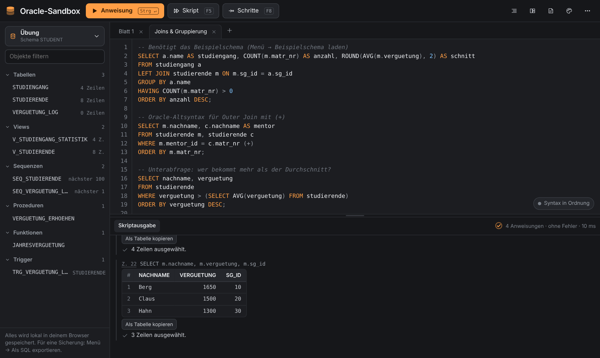
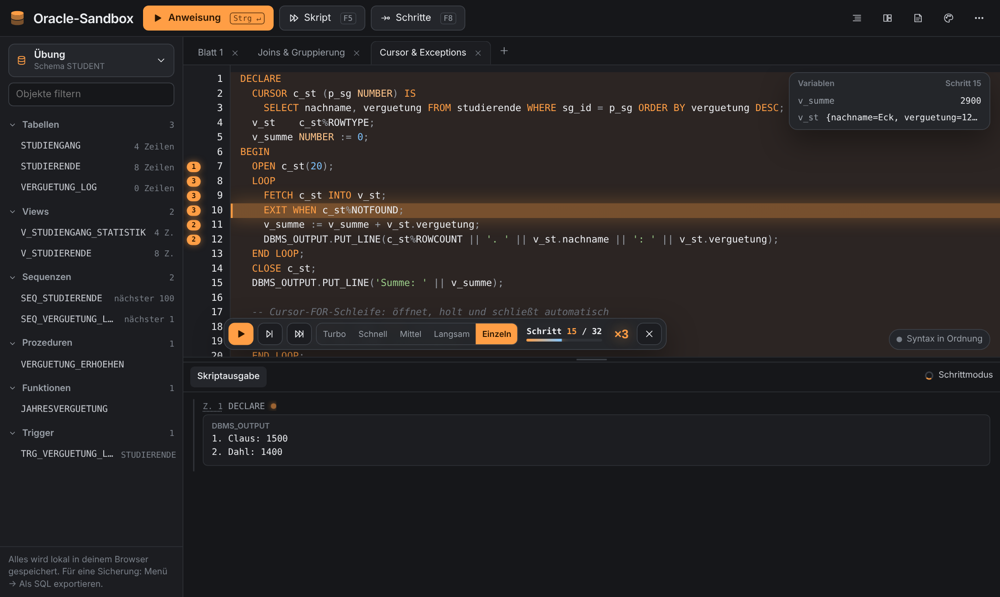

# Oracle-Sandbox

**Oracle SQL und PL/SQL im Browser** – eine vollständige Simulation für Lehre und Übung,
ohne Installation, ohne Server, ohne Internetverbindung. Optional lässt sich dieselbe
Oberfläche mit einem echten Oracle-Server verbinden.

**[▶ Direkt im Browser öffnen](https://inklingsplasher.github.io/oracle-sandbox/)**



## Was sie kann

- **SQL:** Joins inkl. Oracle-`(+)`-Syntax, `GROUP BY` mit `ROLLUP`/`CUBE`, analytische
  Funktionen, `CONNECT BY`, `WITH`, Mengenoperationen, `ROWNUM`, `FETCH FIRST`, `MERGE`
- **PL/SQL:** anonyme Blöcke, Prozeduren, Funktionen, Packages, Trigger (Zeilen-, Anweisungs-,
  `INSTEAD OF`), Cursor, Collections, `BULK COLLECT`, Exceptions, dynamisches SQL
- **Datenbank-Logik:** Constraints, Sequenzen, Identity-Spalten, Views, Transaktionen mit
  `SAVEPOINT`, Data Dictionary (`USER_TABLES`, `USER_SOURCE` …)
- **Fehler wie im Original:** echte ORA-Codes mit deutscher Erklärung und Hinweis
- **Schrittmodus (F8):** zeigt die Ausführung Zeile für Zeile – mit Variablenwerten,
  Schleifenzählern und betroffenen Tabellen, im Tempo von „Einzeln“ bis „Turbo“
- **Alles sichtbar:** Tabellen, Views, Prozeduren, Trigger usw. links im Baum; ein Klick zeigt
  Daten, Spalten, Constraints und Definition
- **Mehrere Datenbanken** und **Import** von SQL-Skripten (z. B. das Mondial-Schema mit
  über 21 000 Anweisungen in unter einer Sekunde)
- **Spickzettel**, fertige Beispiele, Formatierer, Live-Syntaxprüfung, sieben Themes



## Benutzen

Die [Online-Version](https://inklingsplasher.github.io/oracle-sandbox/) öffnen – oder unter
[Releases](../../releases) die Datei `oracle-sandbox.html` herunterladen und doppelklicken.
Vorgeladen ist ein kleines Beispielschema (Studiengänge, Studierende, Views, Funktion,
Prozedur, Trigger).

| Taste | Wirkung |
|---|---|
| Strg+Enter | Anweisung unter dem Cursor ausführen |
| F5 | ganzes Skript ausführen |
| F8 | Schrittmodus |
| Strg+Shift+F | formatieren |

Daten und Arbeitsblätter bleiben im Browser gespeichert (IndexedDB). Sicherung über
Menü (···) → „Als SQL exportieren“, Neustart über „Alles zurücksetzen“.

## Echter Oracle-Server (optional)

Datenbank-Auswahl links oben → „Mit Oracle-Server verbinden …“.

**Brücke – Oracle Net oder ODBC.** Ein Browser spricht weder Oracle Net noch ODBC; das
übernimmt ein kleines Python-Programm im Ordner [`bruecke`](bruecke/):

```powershell
py -m pip install oracledb pyodbc; py bruecke\oracle_bruecke.py
```

Die Brücke zeigt Adresse und Schlüssel an, beides kommt in den Verbindungsdialog.
*Oracle Net* braucht Host, Port und Service-Name (python-oracledb im Thin-Modus, kein
Instant Client nötig, Server ab 12.1); *ODBC* nimmt eine DSN oder eine Verbindungszeichenfolge
(ohne `DBMS_OUTPUT`). Die Sitzung bleibt bestehen, Transaktionen funktionieren wie gewohnt.
Die Brücke lauscht nur auf `127.0.0.1` und verlangt den Schlüssel – sonst könnte jede
geöffnete Webseite über die Sitzung SQL absetzen.

**ORDS – ohne Brücke.** Mit Oracle REST Data Services genügt die Basis-URL eines
REST-aktivierten Schemas (z. B. `https://server:8443/ords/hr`). Voraussetzung: REST-Enabled
SQL ist eingeschaltet und der Ursprung der Seite in den CORS-Freigaben eingetragen. Jede
Ausführung läuft dort in einer eigenen Sitzung und wird am Ende bestätigt.

## Grenzen

Die Simulation deckt den Stoff typischer Datenbank-Vorlesungen ab, ist aber kein Oracle:
Optimizer, Sperren zwischen Sitzungen, Partitionierung, XML/JSON-Funktionen, Objekt-Vererbung
und vieles aus dem Administrationsbereich fehlen. Im Zweifel gilt, was ein echter Server sagt.

## Selbst bauen

Keine Abhängigkeiten außer Node.js ≥ 18:

```sh
npm run build   # erzeugt dist/index.html (eine einzige, eigenständige Datei)
npm test        # Formatierer-Rundlauf und Rauchtest aller Beispiele
```

| Pfad | Inhalt |
|---|---|
| `src/` | Engine: Lexer, Parser, Werte, Abfragen, DML/DDL, PL/SQL-Laufzeit, Builtins, API |
| `ui/` | Oberfläche: Vorlage, Styles, App, Schrittmodus, Datenbankverwaltung, Serveranbindung, Formatierer, Inhalte |
| `bruecke/` | Python-Brücke für echte Oracle-Server |
| `tests/` | Testskripte |

Bei jedem Push auf `master` baut ein Workflow die Seite neu und veröffentlicht sie auf
GitHub Pages; ein Tag `v*` erzeugt ein Release mit der fertigen HTML-Datei.

## Lizenz

[MIT](LICENSE)
